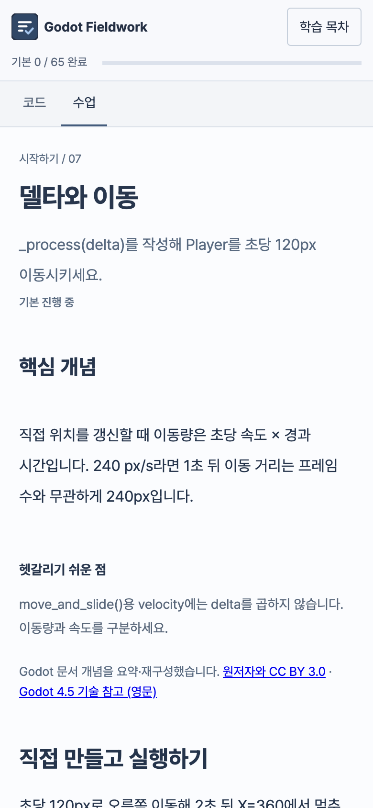

<p align="center">
  
</p>

<h1 align="center">Godot Fieldwork</h1>

<p align="center">
  GDScript를 직접 쓰고, 실제 Godot 엔진으로 실행하며 배우는 한국어 Godot 학습 서비스
</p>

<p align="center">
  <a href="https://chajuhui123.github.io/godot-fieldwork/"><b>서비스 바로가기</b></a>
  ·
  <a href="https://docs.godotengine.org/ko/4.x/">Godot 한국어 공식 문서</a>
  ·
  <a href="LICENSE-CONTENT.md">라이선스</a>
</p>

## Godot Fieldwork

Godot Fieldwork는 [Godot 4.x 한국어 공식 문서](https://docs.godotengine.org/ko/4.x/)의 개념을 바탕으로, 읽은 내용을 바로 코드로 옮겨 보는 실습형 학습 서비스입니다. 브라우저 안에서 **실제 Godot 4.5.1 엔진(WebAssembly)** 이 GDScript를 실행하고, 실행 중인 노드의 값을 검사해 과제를 채점합니다. 설치 없이 링크 하나로 시작할 수 있습니다.

> 독립적으로 제작한 비공식 학습 서비스입니다. Godot Engine 개발팀이나 Godot Foundation의 제작·후원·승인을 받지 않았습니다.

## 기술 스택

**프론트엔드**


**테스트 · 빌드 · 배포**


| 영역 | 사용 기술 |
| --- | --- |
| 화면 | React 19, TypeScript, Vite, Pretendard |
| 코드 편집기 | CodeMirror 6 (GDScript 문법 강조, 초안 자동 저장) |
| 실행 엔진 | Godot 4.5.1 Web 내보내기(단일 스레드 WASM). sandbox iframe과 세션 토큰으로 앱과 분리 |
| 채점 | 실행 중인 노드 상태를 읽는 GDScript 검사기 (`work/curriculum/build.py`가 수업 원본에서 생성) |
| 테스트 | Node.js 테스트 러너(데이터·채점 대조), Playwright(작성 → 실행 → 채점 흐름) |
| 배포 | GitHub Actions → GitHub Pages (정적 호스팅만으로 동작) |

## 서비스 소개

**65개 수업, 6개 과정**
시작하기(12) · 설명서(23) · 엔진 상세 정보(12) · 3D 심화(6) · 셰이더·VFX(6) · 시스템 심화(6)까지, 공식 문서의 흐름을 따라 개념 → 퀴즈 → 실습으로 이어집니다.

**실제 엔진으로 실행하고 채점**
흉내 낸 시뮬레이터가 아니라 Godot 4.5.1이 브라우저에서 코드를 실행합니다. 자동 검사는 "약 0.5초 뒤 Player X가 120~350px인지"처럼 실행 중인 노드의 값을 확인하고, 미통과 항목에는 목표값·이번 실행 값·힌트를 보여 줍니다.

**Godot 에디터와 닮은 작업 화면**
왼쪽 씬 트리, 가운데 `main.gd` 편집기, 오른쪽 Inspector, 아래 게임 미리보기와 검사 결과·Console 탭으로 실제 에디터의 작업 흐름을 익힙니다.

**처음 시작하는 사람을 위한 경로**
문법부터 노드·이동·입력·시그널·스폰·충돌·UI까지 10개 수업을 묶은 추천 트랙 "2D 게임 첫걸음"과 마지막 수업 이어하기를 제공합니다.

**로그인 없이 이 브라우저에 저장**
진도와 작성한 코드는 브라우저 저장소에 남습니다. 현재 코드와 씬을 Godot 프로젝트(ZIP)로 내려받아 데스크톱 에디터에서 이어갈 수 있습니다.

## 화면 구성

### 홈


소개와 학습 시작, 이어하기를 제공합니다.

### 추천 트랙


10개 수업으로 이어지는 "2D 게임 첫걸음"과 진도를 보여 줍니다.

### 실습 화면 · 채점 통과


툴바 배지와 검사 결과 탭에서 통과 여부를 바로 확인합니다. 오른쪽은 수업 본문입니다.

### 실습 화면 · 미통과 항목과 힌트


고쳐야 할 항목을 먼저 보여 주고 목표값, 이번 실행 값, 힌트를 함께 표시합니다.

### 모바일


좁은 화면에서는 코드와 수업을 탭으로 전환합니다.

## 기여자

<table>
  <tr>
    <td align="center">
      <a href="https://github.com/chajuhui123">
        <br/>
        <b>Juhee Cha</b>
      </a><br/>
      <sub>기획 · 개발 · 콘텐츠</sub>
    </td>
  </tr>
</table>

수업 오류, 개선 아이디어, 기여는 [이슈](https://github.com/chajuhui123/godot-fieldwork/issues)로 남겨 주세요. 작업 규칙은 [AGENTS.md](AGENTS.md)를 따릅니다.

## 개발 가이드

### 실행하기

React 19, TypeScript, Vite로 만든 한국어 Godot 실습 사이트입니다. Node.js 22.12 이상(또는 20.19 이상)이 필요합니다.

```sh
npm ci
npm run dev
```

기본 주소는 http://127.0.0.1:4175/ 입니다. Vite가 앱과 Godot 실행 파일을 함께 제공하므로 개발 중에는 별도 엔진 서버가 필요하지 않습니다. 같은 주소에 이미 정적 서버가 실행 중이면 해당 서버를 종료한 뒤 개발 서버를 켜세요. 다른 포트는 `npm run dev -- --port 5173`로 지정합니다. 브라우저 저장소는 주소와 포트별로 나뉘므로 기존 학습 기록을 이어가려면 원래 주소를 사용하세요.

```sh
npm run build    # TypeScript 검사 및 dist/ 생성
npm run preview  # 빌드한 사이트 확인
```

배포할 폴더는 `dist/`입니다. 호스팅 서버는 `runtime/` 파일에 `Access-Control-Allow-Origin: *`를 설정하고 WASM을 `application/wasm`으로 제공해야 합니다. 별도 런타임 호스트를 쓰려면 빌드 전에 `VITE_GODOT_RUNTIME_URL`을 지정하세요(예: `https://example.org/runtime/`). `main`에 머지하면 `.github/workflows/deploy.yml`이 테스트와 빌드를 거쳐 GitHub Pages(`https://chajuhui123.github.io/godot-fieldwork/`)에 배포합니다. GitHub Pages는 모든 파일에 `Access-Control-Allow-Origin: *`를 붙이므로 추가 헤더 설정이 필요 없습니다. 기존 4175 정적 서버에 CORS 설정이 없으면 로컬에서만 포트 4176의 `python3 runtime-src/server.py --port 4176` 서버를 사용합니다.

### 프로젝트 구조

- `src/components/`: 홈, 헤더, 목차, 레슨, 퀴즈, 심화 문제
- `src/data/`: 6개 과정의 수업 순서, 개념, 실습 코드·채점 조건, 출처
- `src/workshop/`: CodeMirror 편집기, Scene/Inspector, 실행 세션, 프로젝트 ZIP 다운로드
- `src/styles/`: 기존 디자인과 반응형 레이아웃
- `public/`: Pretendard, 이미지, 출처 안내, 배포 가능한 Godot 4.5.1 WASM 런타임
- `runtime-src/`: 게임을 구성하고 실제 노드 상태를 채점하는 Godot 프로젝트

홈은 기본 URL과 `#home`, 수업은 `#editor`처럼 기존 해시 주소로 엽니다. 진도는 `godot-fieldwork-progress-v1`, 코드와 Inspector 설정은 `godot-workshop-v1:<수업 ID>`에 기존 형식 그대로 저장합니다.

### 엔진 및 수업 검증

모든 실습은 WebGL 2를 지원하는 브라우저에서 실제 GDScript를 실행합니다. 첫 실행에 약 40MB의 엔진·프로젝트 파일을 불러옵니다. 실행 세션은 sandbox iframe, 송신 창 확인, 세션 토큰으로 분리하고, 수업을 떠나거나 정지하면 정리합니다. 실습용 검사이며 사용자의 코드를 신뢰하는 보안 경계로 쓰지는 않습니다.

```sh
npm test
FIELDWORK_GODOT=/path/to/Godot npm test  # 실제 엔진에서 참고 코드와 미완성 코드 대조
npx playwright install chromium
npm run test:browser                    # 작성 → 실행 → 채점 → 수업 이동
```

확장 수업을 수정한 뒤 `python3 work/curriculum/build.py`로 JSON을 다시 생성하세요. 출처 안내는 `python3 work/content-review/build-credits.py`로 생성합니다. 엔진을 다시 내보낼 때만 Godot 4.5.1과 동일 버전 Web 템플릿이 필요합니다.

```sh
python3 runtime-src/build.py --godot /path/to/Godot --templates /path/to/templates
```

#### 출처 및 교육 내용 검수 (2026-11-05)

서비스의 `credits.html`에 문서·로고·엔진·글꼴·편집기 출처와 라이선스를 표시합니다. 수업별 영어 4.5 기술 참고 링크를 추가했으며, 다운로드 프로젝트도 출처 안내를 포함합니다. 자세한 수정·검증 범위와 남은 한계는 [CONTENT_REVIEW.md](CONTENT_REVIEW.md)를 참고하세요.

#### 소개 홈

기본 URL과 `#home`은 소개 홈을 엽니다. 수업 URL(예: `#editor`)은 그대로 사용할 수 있습니다. 헤더 로고로 홈으로 돌아오면 실행 중인 Godot 런타임을 정리합니다. 홈 구성은 `src/components/Home.tsx`, 스타일은 `src/styles/home.css`와 `src/styles/home-editorial.css`에 있습니다. 홈 이미지의 출처는 `public/assets/home/ATTRIBUTION.txt`에 있습니다.

## 라이선스

- 소스 코드: [MIT](LICENSE)
- 직접 작성한 수업 콘텐츠(퀴즈, 실습 과제, 시작·참고 코드, 채점 조건, 설명 글): [CC BY 4.0](https://creativecommons.org/licenses/by/4.0/)
- Godot 공식 문서를 요약·재구성한 부분: 원문 라이선스 [CC BY 3.0](https://creativecommons.org/licenses/by/3.0/)
- Godot 엔진, 로고, 글꼴, 번들 라이브러리: 각 라이선스 ([LICENSE-CONTENT.md](LICENSE-CONTENT.md))

Godot Fieldwork는 비공식 학습 서비스이며 Godot Engine 개발팀의 승인을 받지 않았습니다.
