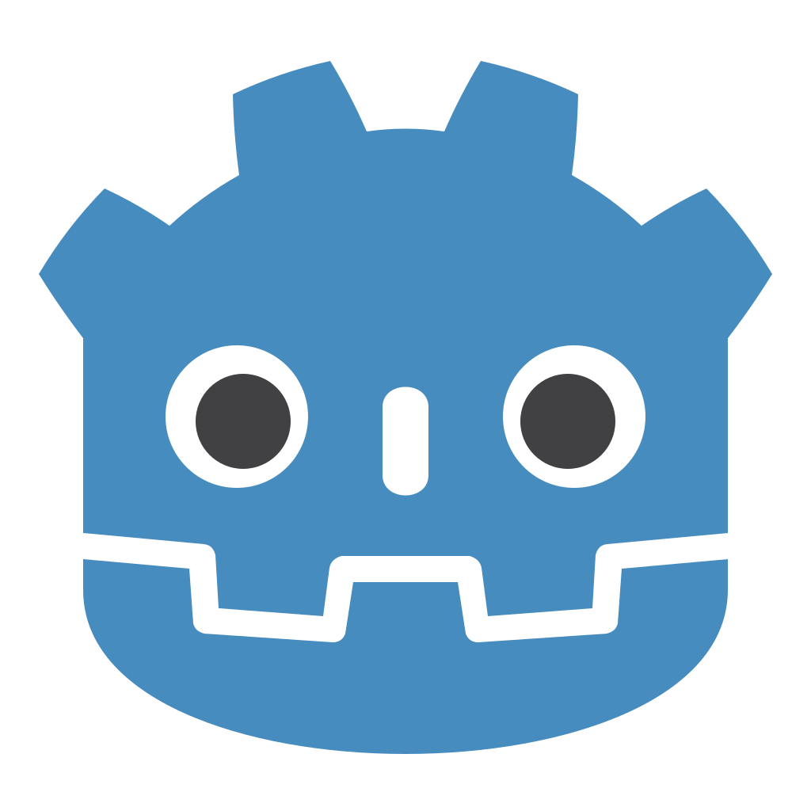
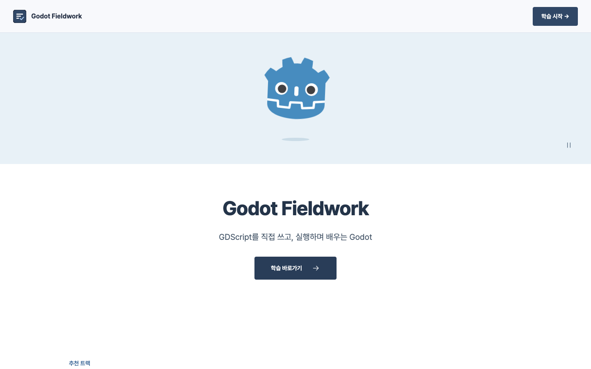
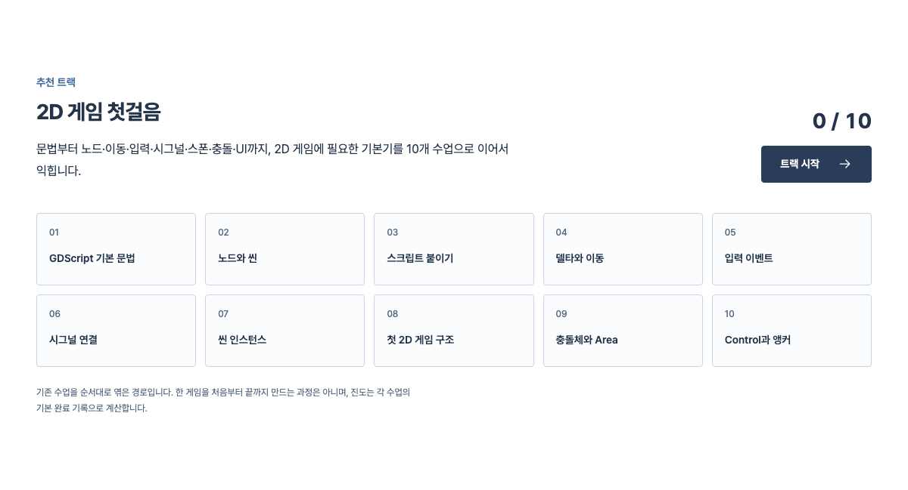
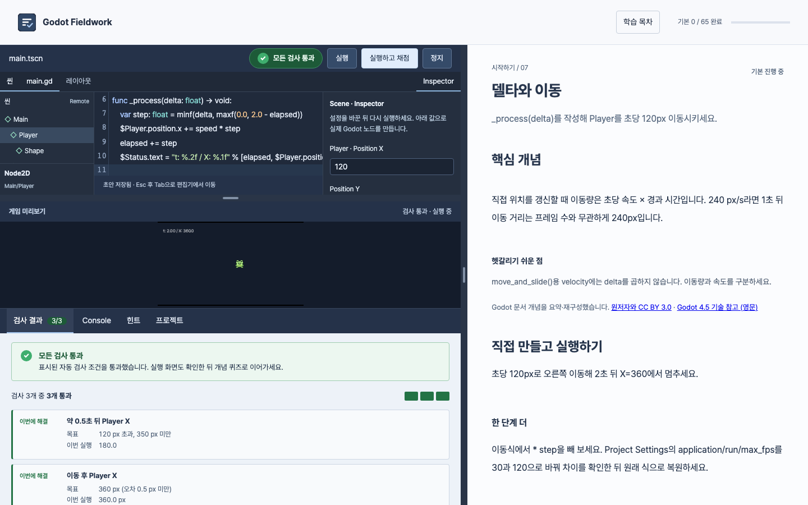
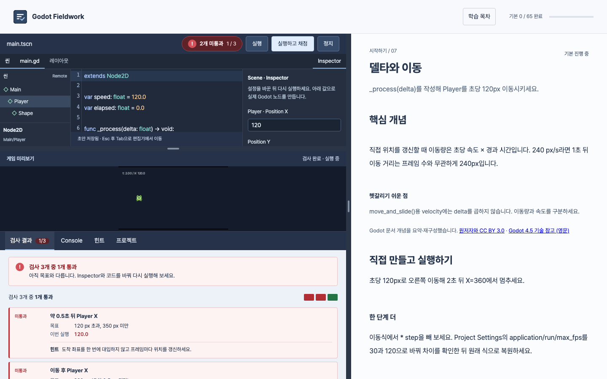

<h1 align="center">Godot Fieldwork</h1>

<p align="center">
  GDScript를 직접 쓰고, 실제 Godot 엔진으로 실행하며 배우는 한국어 Godot 학습 서비스
</p>

<p align="center">
  <a href="https://chajuhui123.github.io/godot-fieldwork/"><b>서비스 바로가기</b></a>
  ·
  <a href="https://docs.godotengine.org/ko/4.x/">Godot 한국어 공식 문서</a>
</p>

> 독립적으로 제작한 비공식 학습 서비스입니다. Godot Engine 개발팀이나 Godot Foundation의 제작·후원·승인을 받지 않았습니다.

## 기술 스택

<p>
        
</p>

## 서비스 소개

<p align="center" >
  
</p>

### 이런 분께 추천드립니다

- Godot을 처음 배우는 분
- 공식 문서를 읽었지만 직접 써 보는 연습이 필요한 분
- 프로그램 설치 없이 바로 시작하고 싶은 분

### 읽고, 풀고, 만듭니다

수업마다 개념 설명 → 퀴즈 → 코드 실습 순서로 진행합니다. 기초부터 3D·셰이더까지 6개 과정, 65개 수업이 있습니다.

### 코드가 게임으로 움직입니다

브라우저 안에서 실제 Godot 엔진이 코드를 실행합니다. 실행 버튼을 누르면 결과 화면이 바로 나타납니다.

### 정답 여부를 바로 확인할 수 있습니다

실행 결과를 자동으로 검사해 통과 여부를 표시합니다. 틀린 부분에는 목표값과 힌트를 함께 보여 줍니다.

### 가입 없이도 이어서 학습할 수 있습니다

진도와 코드는 이 브라우저에 저장됩니다. 혹은 만든 결과를 다운로드 받아 Godot 에디터에서도 계속 작업할 수 있습니다. 처음이라면 추천 트랙 "2D 게임 첫걸음"의 10개 수업을 순서대로 따라가면 됩니다.

<sub>위 이미지는 Godot 엔진의 로고입니다. © 2017 Andrea Calabró, <a href="https://creativecommons.org/licenses/by/4.0/">CC BY 4.0</a> (<a href="https://github.com/godotengine/godot/blob/4.5.1-stable/icon.svg">원본</a>)</sub>

## 화면 구성

<table>
  <tr>
    <td align="center" width="50%">
      <b>홈</b><br/>
      <br/>
      <sub>소개와 학습 시작, 이어하기</sub>
    </td>
    <td align="center" width="50%">
      <b>추천 트랙</b><br/>
      <br/>
      <sub>10개 수업으로 이어지는 "2D 게임 첫걸음"과 진도</sub>
    </td>
  </tr>
  <tr>
    <td align="center" width="50%">
      <b>실습 · 채점 통과</b><br/>
      <br/>
      <sub>툴바 배지와 검사 결과 탭에서 통과 여부 확인</sub>
    </td>
    <td align="center" width="50%">
      <b>실습 · 미통과와 힌트</b><br/>
      <br/>
      <sub>고칠 항목, 목표값, 이번 실행 값, 힌트</sub>
    </td>
  </tr>
</table>

## 개발 가이드

<details>
<summary><b>실행하기, 프로젝트 구조, 검증</b></summary>

### 실행하기

React 19, TypeScript, Vite로 만든 한국어 Godot 실습 사이트입니다. Node.js 22.12 이상(또는 20.19 이상)이 필요합니다.

```sh
npm ci
npm run dev
npm run build    # TypeScript 검사 및 dist/ 생성
npm run preview  # 빌드한 사이트 확인
```

Vite가 앱과 Godot 실행 파일을 함께 제공하므로 개발 중에는 별도 엔진 서버가 필요하지 않습니다. 브라우저 저장소는 주소와 포트별로 나뉘므로 기존 학습 기록을 이어가려면 원래 주소를 사용하세요.

### 프로젝트 구조

- `src/components/`: 홈, 헤더, 목차, 레슨, 퀴즈, 심화 문제
- `src/data/`: 6개 과정의 수업 순서, 개념, 실습 코드 및 채점 조건, 출처
- `src/workshop/`: CodeMirror 편집기, Scene/Inspector, 실행 세션, 프로젝트 ZIP 다운로드
- `src/styles/`: 기존 디자인과 반응형 레이아웃
- `public/`: 에셋, 출처 안내, 배포 가능한 Godot 4.5.1 WASM 런타임
- `runtime-src/`: 게임을 구성하고 실제 노드 상태를 채점하는 Godot 프로젝트

홈은 기본 URL과 `#home`, 수업은 `#editor`처럼 기존 해시 주소로 엽니다. 진도는 `godot-fieldwork-progress-v1`, 코드와 Inspector 설정은 `godot-workshop-v1:<수업 ID>`에 저장합니다.

### 엔진 및 수업 검증

실습은 WebGL 2를 지원하는 브라우저에서 실제 GDScript를 실행합니다. 첫 실행에 약 40MB의 엔진, 프로젝트 파일을 불러옵니다.

실행 세션은 sandbox iframe, 송신 창 확인, 세션 토큰으로 분리하고, 수업을 떠나거나 정지하면 정리합니다. 실습용 검사이며 사용자의 코드를 신뢰하는 보안 경계로 쓰지는 않습니다.

```sh
npm test
FIELDWORK_GODOT=/path/to/Godot npm test  # 실제 엔진에서 참고 코드와 미완성 코드 대조
npx playwright install chromium
npm run test:browser                    # 작성 → 실행 → 채점 → 수업 이동
```

확장 수업을 수정한 뒤 `python3 work/curriculum/build.py`로 JSON을 다시 생성하세요. 출처 안내는 `python3 work/content-review/build-credits.py`로 생성합니다. 엔진을 다시 내보낼 때만 Godot 4.5.1과 동일 버전 Web 템플릿이 필요합니다.

```sh
python3 runtime-src/build.py --godot /path/to/Godot --templates /path/to/templates
```

#### 출처 및 교육 내용 검수 (2026-11-05)

서비스의 `credits.html`에 문서·로고·엔진·글꼴·편집기 출처와 라이선스를 표시합니다. 수업별 영어 4.5 기술 참고 링크를 추가했으며, 다운로드 프로젝트도 출처 안내를 포함합니다. 자세한 수정·검증 범위와 남은 한계는 [CONTENT_REVIEW.md](CONTENT_REVIEW.md)를 참고하세요.

</details>

## 라이선스

- 소스 코드: [MIT](LICENSE)
- 직접 작성한 수업 콘텐츠(퀴즈, 실습 과제, 시작·참고 코드, 채점 조건, 설명 글): [CC BY 4.0](https://creativecommons.org/licenses/by/4.0/)
- Godot 공식 문서를 요약·재구성한 부분: 원문 라이선스 [CC BY 3.0](https://creativecommons.org/licenses/by/3.0/)
- Godot 엔진, 로고, 글꼴, 번들 라이브러리: 각 라이선스 ([LICENSE-CONTENT.md](LICENSE-CONTENT.md))

Godot Fieldwork는 비공식 학습 서비스이며 Godot Engine 개발팀의 승인을 받지 않았습니다.

## 기여자

<table>
  <tr>
    <td align="center">
      <a href="https://github.com/chajuhui123">
        <br/>
        <b>Juhee Cha</b>
      </a><br/>
      <sub>기획 · 개발 · 콘텐츠</sub>
    </td>
  </tr>
</table>

수업 오류, 개선 아이디어, 기여는 [이슈](https://github.com/chajuhui123/godot-fieldwork/issues)로 남겨 주세요.
